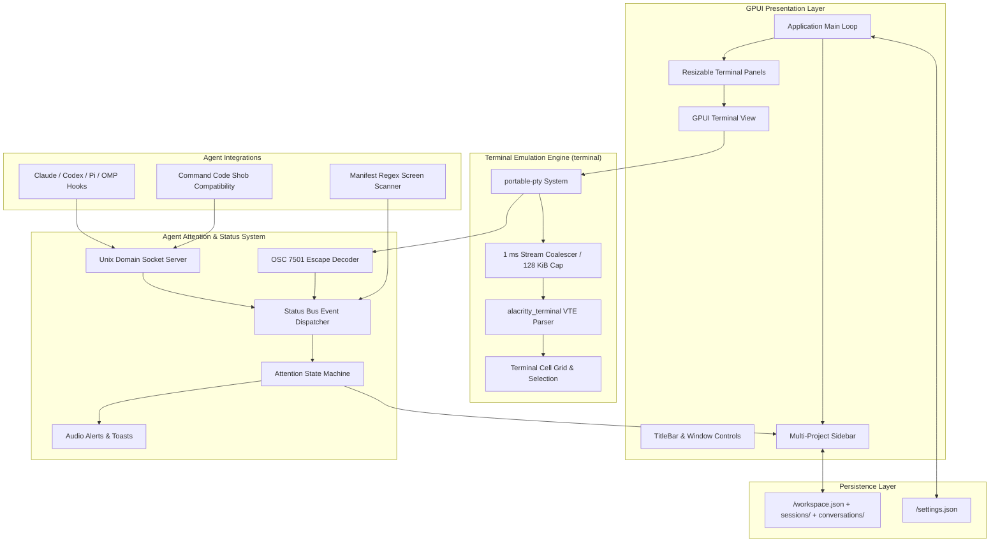
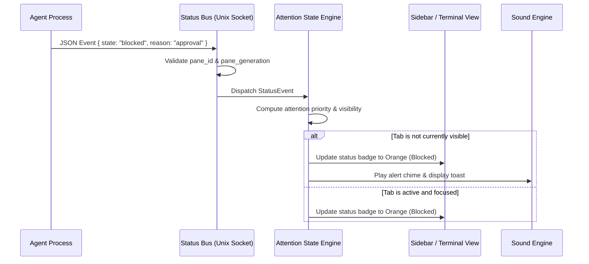

# Shob Architecture

This document describes the architectural design, core subsystems, and data flows of the **Shob** terminal emulator.

---

## 1. System Overview

Shob is designed around three primary concerns:
1. **High-throughput, GPU-accelerated terminal emulation** using GPUI and Alacritty's VTE parser.
2. **Autonomous AI agent state tracking** via an IPC status bus and the Shob attention protocol.
3. **Multi-project workspace management** with persistent project-scoped terminal sessions.



---

## 2. Core Subsystems

### 2.1 Terminal Emulation (`terminal`)

The terminal widget is implemented in the `terminal` sub-crate:
- **PTY Management**: Shell preparation and I/O threads start on first render or explicit input. Already-started shells remain live when hidden; idle cache eviction never closes a PTY or discards its grid.
- **Throughput Protection**: Uncontrolled terminal streams (e.g., fast compiler output or large file dumps) can overwhelm desktop UI threads. Shob employs an adaptive **1 ms stream coalescer** and a **128 KiB parse cap per frame**. This ensures UI responsiveness even at stream rates exceeding 40 MB/s.
- **Rendering**: Terminal glyphs and styling (bold, italic, 24-bit RGB true color) are painted directly via GPUI primitives using embedded monospace fonts (`Mononoki`).

### 2.2 Status Bus & IPC (`src/status_bus.rs`, `src/status.rs`)

The status bus receives events from running agent processes:
- **Unix Domain Socket**: Shob binds a private per-user Unix socket at `$XDG_RUNTIME_DIR/shob-status.sock` (or `/tmp/shob-$UID/status.sock`).
- **Generation Authentication**: Each terminal pane receives a unique `pane_generation` token in its environment (`SHOB_PANE_GENERATION`). The status bus verifies this token to reject stale or unauthorized events from old processes.
- **OSC 7501 Fallback**: For environments where local sockets cannot be bridged, agents can emit custom OSC 7501 ANSI sequences directly to stdout (`\x1b]7501;state=working...\x1b\`).

### 2.3 Agent Attention Model (`src/attention.rs`)

Shob implements the agent attention model to eliminate notification fatigue while guaranteeing critical tasks are never missed:
- **Attention Hierarchy**:
  $$\text{Blocked} > \text{Done} > \text{Working} > \text{Idle}$$
  - `Error` ranks as `Blocked`.
  - `Unknown` and `Active` rank as `Idle`.
- **Unviewed Completion Latching**:
  - When an agent finishes while focused and visible, its status transitions directly to `idle`/`active` without ringing bells.
  - When an agent finishes while unfocused or in a hidden tab, its status latches to `done`. An audio alert plays and a notification toast appears. Switching to that tab automatically clears the status to `idle`.
- **Sub-Agent / Worker Hierarchy**: Child sessions (reporting an `agent_id`) are grouped under their parent session without raising independent notifications or corrupting the parent's status.

### 2.4 Agent Integrations (`src/integrations.rs`, `src/agent_rules.rs`)

Shob provides automated one-command setup for developer agent ecosystems:
- **Claude Code**: Hooks registered into `~/.claude/settings.json`.
- **Codex**: Hooks registered into `~/.codex/hooks.json`.
- **Pi & OMP**: Extension modules placed into dedicated agent directories.
- **OpenCode**: Upstream V2 TUI session listener plugin (`assets/integrations/opencode-tui.js`).
- **Command Code**: Direct native compatibility via socket environment variables (`SHOB_SOCKET_PATH`, `SHOB_PANE_ID`).
- **Screen Detection**: Embedded TOML manifests (`assets/agent-detection/*.toml`) evaluate regex patterns on visible terminal screen buffers to detect agent activity without requiring agent configuration.

### 2.5 Workspace State & Persistence (`src/workspace_state.rs`, `src/settings.rs`, `src/conversations.rs`)

Shob follows Zed's per-platform directory convention (`src/paths.rs`):

| Platform | Data dir | Config dir |
|---|---|---|
| Linux | `$XDG_DATA_HOME/shob` (`~/.local/share/shob`) | `$XDG_CONFIG_HOME/shob` (`~/.config/shob`) |
| macOS | `~/Library/Application Support/Shob` | `~/.config/shob` |
| Windows | `%LOCALAPPDATA%\Shob` | `%APPDATA%\Shob` |

```
<data>/
  workspace.json              # v2: projects -> sessions (tabs) -> panes + split tree
  sessions/<pane-uid>.txt     # captured terminal output per pane (2 000 lines / 256 KiB cap)
  conversations/<pane-uid>/   # append-only JSONL agent transcripts
  backups/                    # pre-v2 workspace backups
  logs/
<config>/settings.json        # theme, palette, sidebar, default model, window geometry, restore toggles
```

- `settings.json` is user-editable and parsed as JSONC (comments allowed). It stores app appearance, window bounds/state, and the `restore` toggles.
- `workspace.json` is auto-managed and debounced (300 ms) with an atomic temp+rename write and a generation guard. It records project paths, tab titles/logos, the split tree, per-pane cwd, input drafts, command history, and selected agent models/session ids.
- Scrollback is written separately (on close, quit, and every 30 s while dirty) so the debounced hot path stays small. Restored panes seed the previous buffer; a fresh shell starts in the saved cwd only when shown or sent input.
- Agent transcripts are appended as raw events and replayed through `push_chat_event`, so the restored UI matches the previous session exactly. Embedded sessions reopen their durable session id. Historical OMP sessions restore their transcript.
- Window geometry is loaded synchronously before `open_window`, validated against the current displays, and saved on close/quit.
- Legacy v1 `workspace.json` files (including the old `com.Markup.Markup` location) are backed up to `<data>/backups/` and migrated automatically.

Environment overrides: `SHOB_DATA_DIR=/absolute/path` (derives config/state/logs from it) and `SHOB_DISABLE_RESTORE=1` (clean launch without reading saved state).

### 2.6 Embedded shob agent (`agent/`)

The v0.21.0 library crates and CLI sources are vendored as a Git subtree
under `agent/` and kept as its own Cargo workspace. Non-build upstream assets
(website, docs, scripts, packaging, deploy/demo, CI metadata and most examples)
were removed after import; `examples/plugin-stub` remains as a test fixture.
Shob path-depends on `agent/crates/embedded`, a host-facing library built
from the upstream library crates.

- **Default backend.** `src/agent_bridge.rs` opens an `EmbeddedSession` on the first
  prompt, not while restoring or selecting a conversation. Each session owns a
  dedicated multi-thread Tokio runtime and reuses upstream's `cli::session::build`:
  model/credential resolution,
  built-in `read`/`bash`/`edit`/`write`/`docs` tools, the coding system prompt,
  durable JSONL session storage and `AgentHarness`.
- **Typed transport.** A dedicated host emitter retains shared tool snapshots
  before projecting text. Raw and projected queues each allow 256 records /
  4 MiB, admitting one oversized final record exclusively. Async text/lifecycle
  delivery backpressures without blocking runtime workers; intermediate
  identified snapshots can coalesce. GPUI drains 64 records / 256 KiB per pane
  and resignals pending work. The default backend uses no `shob` subprocess.
- **Lifecycle.** Prompts run on the session runtime. Inactive, idle panes release
  embedded runtimes only after command completion, durable writes, and empty
  event/request and native-work queues; the next prompt reopens the durable id.
  View caches are disposable, but transcript text, list anchors, terminal grids,
  shells, and attention state survive eviction. Running/blocked sessions and
  queued work stay live. RPC runtimes remain resident without a safe idle proof.
  Stop and pane close cancel active tools through `request_stop_round` +
  `abort_reclaiming`. A stale resumed id falls back to a fresh durable session.
- **Discovery and login.** Model catalogs and provider readiness are read
  in-process through `embedded::catalog`/`providers`. shob-only API-key and
  OAuth logins are driven in-process through the embedded provider configuration.
- **Baseline.** `SHOB_AGENT_BACKEND=rpc` runs `shob --mode rpc` as a child process
  for before/after measurements; no separate agent executable is needed.
  `SHOB_STREAM_TIMINGS=1` reports startup, UI drain/apply, render, markdown parse
  and tool arrival→card/output percentiles for both backends.
- **Isolation.** Embedded sessions build with `no_extensions` because upstream
  extension identity is process-global. Built-in tools/providers, `models.json`,
  `auth.json`, environment credentials and session storage are reused.
- **Content search.** The built-in `grep` embeds ripgrep's matcher and searcher.
  Native searches stream files on a blocking worker and discover directories
  incrementally, retaining ignore rules, deterministic breadth-first ordering,
  cancellation and bounded output without an external `rg` process.
- **Shell execution.** `tokio::process::Command` runs Bash/PowerShell with
  concurrently driven stdin, stdout, stderr, status, cancellation and deadlines.
  An eight-record output channel feeds a bounded tail and complete asynchronous
  log spool. First output is immediate; subsequent UI checkpoints use one
  execution-local 16 ms timer, including quiet periods. Timeouts do not add a
  post-reap sleep. Interrupted/dropped calls clean up their process groups.
- **Failure visibility.** The capture layer also retains the first 6 KiB of
  output, filled once from the leading chunks and never grown. When a command
  fails and its output was truncated, the terminal result shows a bounded head
  window, an exact elided-line count, the tail and the full-log path, so a cause
  printed near the start is not hidden by a tail-only limit. The window is built
  from a recorded exit code (never inferred from text), performs no filtering or
  summarisation, and is refused unless strictly smaller than the output it
  replaces; successful commands keep the tail-only format unchanged. See
  `agent/crates/tools/src/output_window.rs`.
- **Interactive PTYs.** `terminal::pty_session` owns setup, resize, termination,
  reaping and handle destruction off GPUI, using the existing smol pool and
  worker-only deferred I/O. One FIFO writer bounds accepted/in-flight input to
  32 MiB / 4,096 frames. Submission pacing starts after physical-write receipts;
  refusals/failures remain visible and retain drafts. Parser/restoration batches
  stay at most 128 KiB and yield between batches. Reader EOF is not a fake child
  exit code.
- **Persistence and RPC.** Conversation fields are capped before copying into a
  256-entry / 8 MiB writer queue; overload/disk failures surface in chat.
  Optional RPC spawn/restart/kill/wait/join run on lifecycle workers, not GPUI.

See [SHELL_TOOL_AUDIT.md](SHELL_TOOL_AUDIT.md) for measured baselines, final
timings, dependencies, file inventory and remaining limits.

See `EMBEDDED_AGENT.md` for the upstream commit, integration details, verification
and remaining limitations.

### 2.7 Native Gemini API

The embedded model catalog registers `google/gemini-3.8-flash`. The Rust
OpenAI-compatible HTTP transport sends requests to Google's Gemini API,
streams text and reasoning, and carries Gemini thought signatures through
tool calls and history. The host uses the embedded before-tool-call hook to
ask for approval before running tools other than file reads and searches.
The separate `google-antigravity` provider uses Cloud Code Assist streaming and
registers Gemini 3.8 Flash, Claude Sonnet 4.6, and the Gemini Flash-Lite models,
so a congested 3.8 route can be swapped for a faster one without changing
providers. The embedded login worker performs OAuth with PKCE over a loopback
redirect, discovers the account's project, and renews its credential from the
local Antigravity auth store. The provider reuses the same event batching and
tool approval path as the public Gemini API.

### 2.8 Native provider catalog and authentication

`runtime::catalog` embeds a frozen, MIT-licensed provider/model snapshot from
Oh My Pi revision `73d7521269a1212fc2b2790a2e8c08424496c953`, unioned with
Shob's existing identities. Provider endpoints, wire APIs, capabilities and
credential environment aliases are native Rust metadata; no OMP code executes.
Explicit `models.json` configuration retains precedence. Server/account model
discovery supplies real model IDs for dynamic providers.

`embedded::catalog()` exposes every catalog identity; `chat_catalog()` is the
agent picker surface. Non-chat model metadata remains available through
`runtime::catalog::model_metadata`. Unsupported non-chat/auxiliary protocols
cannot block resolution of unrelated chat providers.

`cli::native_auth` implements browser PKCE, device grants, provider-specific
sign-in and token renewal using the same atomic `auth.json` store as inference.
Native and extension OAuth refreshers compose without replacing extensions.
Capability lookup is side-effect-free on the UI thread; extension capabilities
are discovered in the background and cached per project. Cloud requests acquire
AWS SDK credentials or Google ADC at request time, not during local discovery.

### 2.9 Streaming presentation and diagnostics

- Provider transports retain their existing immediate-first-delta behavior,
  bounded event delivery and structural flushes. Embedded host wakes coalesce
  per session before acquiring callback locks; polling acknowledges before a
  bounded drain and resignals any backlog. No UI delivery timer is added.
- The workspace root and per-pane chat view use definite-size cached GPUI
  boundaries. Text/reasoning deltas notify only the chat entity; lifecycle,
  approval and metadata changes still notify root. Separate `Render`
  implementations alone do not isolate GPUI-fast's update dependencies.
- Settled Markdown appends immutable source chunks; the parser processes only
  new chunks. Completion parses the canonical document once to resolve
  cross-block references. An ancestor-viewport flow index virtualizes long
  messages without a nested vertical scroll region. Block heights remain
  usable as estimates across unmounts and width changes. Prepaint clips to
  the height reserved by the outer list and feeds corrections back into the
  next layout, preserving the reader's logical anchor.
- `components/src/text/text_view.rs` parses Markdown/HTML and highlights code
  on the background executor, including the first parse. Initial Markdown has
  an immediate selectable native-text view. One desired document, one active
  parse and one completed result bound pending work. Compatible append-only
  completions publish monotonically; replacement/style/theme epochs prevent
  stale content from another document from committing.
- PTY parsing retains its 128 KiB cap and cooperative foreground scheduling.
  Snapshot text groups cells into style runs without per-cell strings; search
  painting selects row-local ranges from the ordered match list. One
  cancellable timer delivers an owed throttled search refresh even if output
  stops.
- `SHOB_STREAM_TIMINGS=1` reports queue admission/lock/backpressure/residence,
  projection, UI apply, Markdown parse/wait, first-token paint and first tool
  snapshot-to-paint timings. `SHOB_DIAGNOSTICS=1` adds PTY read-to-parse,
  queue depth, read-to-paint and parse-to-paint counters, CPU and RSS.
  Paint timestamps end at CPU paint-command recording, not compositor scanout.

See [STREAMING_PERFORMANCE.md](STREAMING_PERFORMANCE.md) for evidence,
reproduction commands and measurement limitations.

### 2.10 Session lifecycle and memory (`src/session_lifecycle.rs`)

Memory follows attention: `Active -> Idle -> Hibernated`. A session is `Active`
while it is visible, focused, or has work in flight; `Idle` once it is neither,
which releases disposable render caches and any releasable agent bridge. After
`memory.hibernate_after_secs` of no input or output, a *quiescent* pane
hibernates: `TerminalView::hibernate` snapshots the newest 2 000 lines as text,
replaces the alacritty grid with an empty one at the same dimensions, and keeps
the PTY, the shell, the shell-integration scanners and a 256 KiB backlog of new
output. The grid is the dominant per-pane allocation — 24 bytes per cell, plus
alacritty's up-to-1 000 retained spare rows — so this is where an unviewed
workspace's memory goes. A pane with a foreground command, alternate screen,
agent turn, chat, or preview is never hibernated, so no process is stalled or
killed silently; output that arrives anyway is buffered, never parsed, and never repainted.

Waking is a render: replaying the kept text and backlog into a fresh grid takes
no disk read and is indistinguishable from restored scrollback, which is already
text-only. `TerminalView::buffer_text` reports that text while asleep, so a quit
during hibernation persists the same history as one during Idle. The policy is
pure and unit-tested against injected time; thresholds come from `settings.json`
and `SHOB_IDLE_SECS` / `SHOB_HIBERNATE_SECS` / `SHOB_DISABLE_HIBERNATION`.
`SHOB_DIAGNOSTICS=1` reports per-pane estimates, and the app asks glibc to
`malloc_trim` after dropping a grid so RSS follows the heap down.

### 2.11 Token Efficiency Layer (`src/token_efficiency/`)

- A host-side token-reduction layer that runs inside the embedded agent loop via
  the `before_tool_call` / `after_tool_call` hook slots, mapping
  `AgentToolResult` → text → pure decision → `AfterToolCallResult`.
- The decisions live in pure functions over plain data so they test without a
  harness; the module is the only place that names shob types, and it stays a client
  of the hooks. The dependency direction is `shob → token-efficiency → embedded`,
  never the reverse, so upstream subtree syncs stay merge-clean.
- Covers read dedupe, search cache, anchor edits, output minimization, cheap-task
  routing, the prompt-prefix guard, and per-turn token/cache-hit metrics. All
  switchable via `AppSettings::token_efficiency` / `SHOB_TOKEN_EFFICIENCY=0`.
- Design record and invalidation contract: `src/token_efficiency/README.md`.

---

## 3. Data Flow: Agent Event to UI Update


