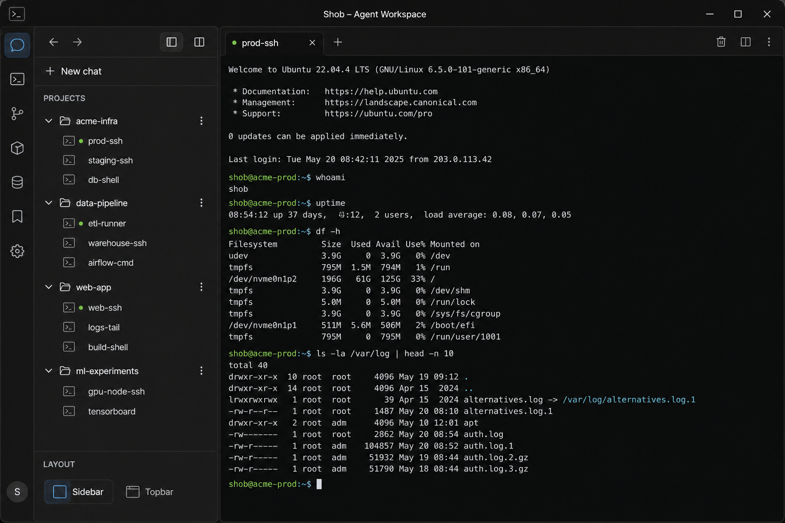
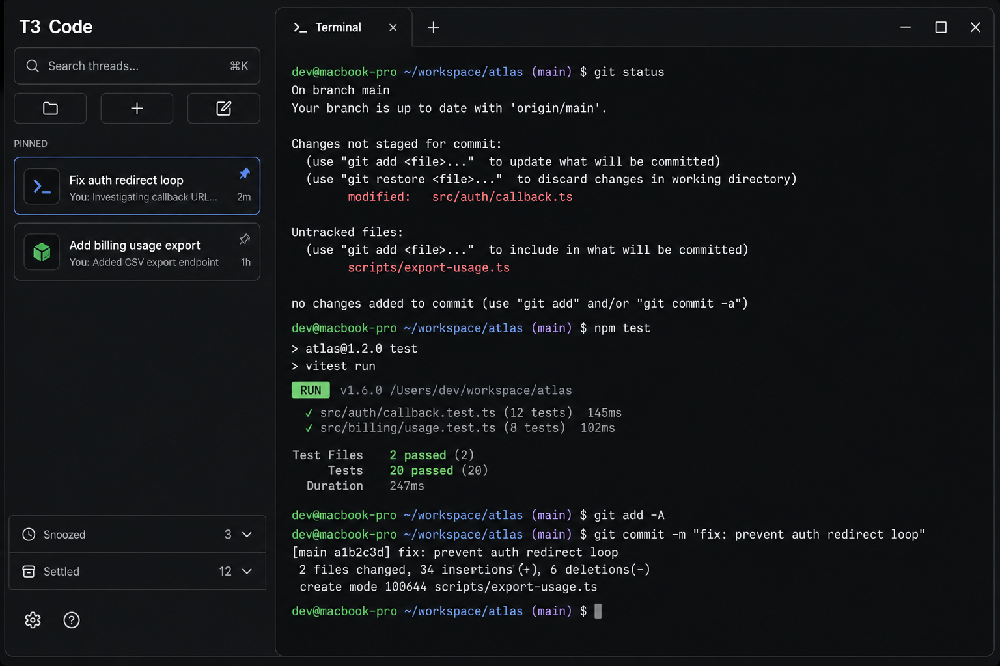

# Sidebar: before and after

The default sidebar now uses T3 Code's flat thread-inbox semantics. The original Shob project tree remains available from Settings → Sidebar → Projects.

## Before

Legacy behavior: a separate activity rail, project-tree toolbar, per-project session rows, a running-sessions shelf, and a layout switch footer.

## After

Current behavior: always-visible search, source filter, add project, square-pen New thread, pinned and active thread cards, bottom Snoozed/Settled shelves, and icon-only utility chrome. No project headings are shown at rest.

> The two images are design/reference captures produced for this UI change. They are not automated runtime screenshots: this sandbox has no Rust toolchain, so the native GPUI app could not be launched here.

## Behavior notes

- Pinned threads come first and can be reordered from the row menu.
- Settled shows 10 rows initially, then 25 more per click.
- Snoozed and Settled shelves are closed by default and pushed to the bottom.
- Archived threads are excluded from the inbox but can be restored in Settings.
- The active thread is always revealed, even when filtered, parked, or archived.
- A one-project filter makes New thread start in that project. Shift-click and multi-project scopes use the viewed project or open the searchable project picker.
- Sidebar style, project scope, shelf expansion, and per-thread metadata are persisted across restores.
